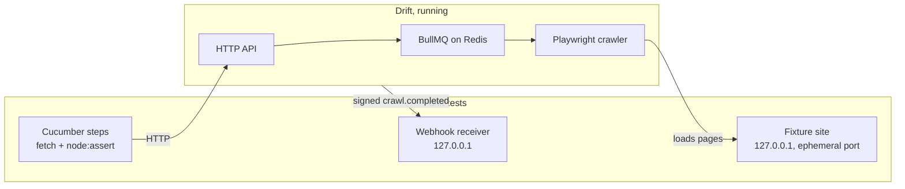

# drift-tests: architecture

How the suite reaches Drift, what it serves and listens on, what it checks, and how CI runs it.
Each decision says what it costs.

## Contents

- [Overview](#overview)
- [What the suite covers](#what-the-suite-covers)
- [Boundaries and security](#boundaries-and-security)
- [Fixtures and scenarios](#fixtures-and-scenarios)
- [The contract](#the-contract)
- [Testing and CI](#testing-and-ci)
- [Platform and stack](#platform-and-stack)
- [Known trade-offs](#known-trade-offs)

## Overview

Feature files in [`features/`](features) state Drift's API behaviour in plain language. Step
definitions in [`features/steps/`](features/steps) call a running Drift over HTTP and assert on the
responses. [`features/support/`](features/support) holds the world (the Drift URL, the last
response, the stored audit), the hooks, the fixture site, the webhook receiver and the generated
contract types.

The suite does not start Drift. CI starts it, or a developer runs `npm run dev:server` in a Drift
checkout. `BeforeAll` waits for Drift to answer, then starts the fixture site.

## What the suite covers

Six feature files, 18 scenarios.

| Feature                    | Scenarios                                                                                                                                                                                                                                                                                            |
| -------------------------- | ---------------------------------------------------------------------------------------------------------------------------------------------------------------------------------------------------------------------------------------------------------------------------------------------------- |
| `discover.feature`         | A site with no sitemap is discovered through its homepage links. A missing URL is `400`. A non-HTTP scheme and an unresolvable host are `422` with a message.                                                                                                                                        |
| `crawl.feature`            | A usable URL is `202 { jobId }`. A missing URL is `400`. A malformed URL is `422` with a message.                                                                                                                                                                                                    |
| `lifecycle.feature`        | A reachable site ends `completed` and its audit is `200`. An unreachable target ends `failed` with a reason, and its audit is `409`. An unknown job id is `404`.                                                                                                                                     |
| `audit.feature`            | The audit has a summary, colour families and contrast findings. It reports the fixture's near-duplicate colour, off-grid spacing, off-scale type size and failing contrast pair. `summary.pages` is the number of pages crawled, and every colour swatch and contrast pair cites only crawled pages. |
| `webhooks.feature`         | A `callbackUrl` that is loopback and not allowlisted (`localhost`), private (`10.0.0.1`), non-HTTP, or not a string is `422`.                                                                                                                                                                        |
| `webhook-delivery.feature` | A completed crawl is POSTed to a local receiver as `crawl.completed` with the audit, an `x-drift-event` header, and an `x-drift-signature` that matches the HMAC-SHA256 of the body.                                                                                                                 |

Not covered: the `queued` and `active` statuses, `crawl.failed` delivery, delivery retries,
redirects from a receiver, WebSocket progress and Drift's export. See
[Known trade-offs](#known-trade-offs).

## Boundaries and security

The suite makes no request off the machine. It talks to Drift at `DRIFT_URL` (default
`http://127.0.0.1:3001`), and Drift crawls the fixture site and delivers webhooks on `127.0.0.1`.

### Over HTTP only

**Decision.** The suite reaches Drift through its HTTP API and imports nothing from Drift's source.

**Reason.** Each scenario checks a response from a running service with Redis, BullMQ and
Playwright behind it. Importing Drift's code would test the implementation rather than the service.

### Webhooks

**Decision.** `webhooks.feature` checks the callback URL at enqueue time: loopback that is not
allowlisted, private, non-HTTP and non-string callbacks are each a `422` on the enqueue request.
`webhook-delivery.feature` starts a receiver on `127.0.0.1`, enqueues a crawl with it as the
callback, and checks that `crawl.completed` arrives with the audit, the `x-drift-event` header, and
an `x-drift-signature` equal to the HMAC-SHA256 of the raw body under `DRIFT_WEBHOOK_SECRET`.

**Reason.** Delivery to a loopback receiver works because Drift's `DRIFT_WEBHOOK_ALLOWED_HOSTS`
exempts listed hosts from the address check, and a deployment uses the same setting for an internal
receiver, so the test uses no test-only code path. The allowlist matches the host as written, so
the loopback scenario uses `localhost`, which is not listed and still resolves to loopback.

## Fixtures and scenarios

### A local fixture site

**Decision.** The suite serves its own [fixture site](features/support/fixtureSite.ts): three pages
on an ephemeral `127.0.0.1` port, started once in `BeforeAll`, with no sitemap and no `robots.txt`.
Its stylesheet is inconsistent on purpose:

- `#3366cc` and `#3467cc`: CIEDE2000 ΔE 0.34, a near-duplicate colour.
- `padding: 13px` and `7px`: off the 4px grid.
- `font-size` 15, 23 and 31px: off the fitted modular scale.
- `#999999` text on `#ffffff`: 2.85:1, below AA for normal text.

**Reason.** Pointing Drift at a public site makes the suite depend on that site's uptime, markup and
DNS, and the audit changes whenever the site does. A fixed fixture lets scenarios assert specific
findings, and every run crawls the same input.

### An explicit page list for crawls

**Decision.** Crawl scenarios send all three fixture URLs as `pages` instead of relying on Drift's
link walk.

**Reason.** Discovery has its own scenario in `discover.feature`. A crawl scenario that also
depended on discovery order would fail for two unrelated reasons.

### The failed crawl

**Decision.** A crawl that reads no page must end `failed` with a reason, and its `/audit` must be
`409`. The suite crawls `http://127.0.0.1:9/`: the URL passes Drift's validation and is queued, and
nothing listens on port 9, so the crawl fails in Playwright.

**Reason.** An all-zeros `200` audit looks like a site with no colours.

### Page attribution

**Decision.** `audit.feature` checks that `summary.pages` equals the number of fixture pages, that
no colour swatch or contrast pair cites more pages than that, and that every cited URL is a fixture
page.

**Reason.** A single-page test cannot catch an aggregation that counts one page twice or keeps
pages from another crawl. The other inventory entries carry tags and properties instead of pages,
so they are not checked.

### The export is not tested

**Decision.** The suite checks the `/audit` `summary` counts and `contrast` findings that Drift's
export (`health`, `findings`, `verdicts`, `rules`) is built from, not the export itself.

**Reason.** The export is built in Drift's React client from the `/audit` response, and no endpoint
returns it. If an endpoint is added, `export.feature` would test it.

**Alternatives.** Drift issue #3 would have added an export endpoint. It was closed while Drift's
public deployment stays a replay.

## The contract

### Generated contract types

**Decision.** `features/support/contract.d.ts` is generated from Drift's published `openapi.yaml`
by `npm run generate`. CI regenerates it against the Drift it clones and fails if the committed file
differs.

**Reason.** Without Drift's types, response bodies are `any` and narrowed at each assertion.
Importing `SiteAudit` from Drift would type the suite against the implementation it tests, and it
would still compile after the contract changed. Generated types avoid both.

**Alternatives.** The types were first committed without the generator script, and two response
descriptions were still the old text a month after Drift changed them. The regeneration check was
added after that.

The steps do not use the generated types yet, so five `@typescript-eslint/no-explicit-any` warnings
remain: three in `world.ts` (the response body, the stored audit, the JSON parser's return) and two
in `webhookReceiver.ts` (the received body and its parse). The rule stays a warning until the steps
use the types, then becomes an error.

## Testing and CI

[`.github/workflows/ci.yml`](.github/workflows/ci.yml) has five jobs, listed in
[README § In CI](README.md#in-ci). `Lint`, `Links`, `Format` and `Typecheck` need only the suite.
`Test` stands Drift up:

1. A Redis service container, because Drift runs crawls as BullMQ jobs.
2. A checkout of Drift with its tags, and Node from Drift's `.nvmrc`.
3. `npm ci` and Chromium in the Drift checkout, then the backend in the background with
   `DRIFT_CRAWL_ALLOWED_HOSTS`, `DRIFT_WEBHOOK_ALLOWED_HOSTS` and `DRIFT_WEBHOOK_SECRET`. A bounded
   loop waits for `POST /discover` to return `400`, the documented answer to a missing URL, with
   connect and total timeouts on each probe.
4. `npm run generate` against the cloned `openapi.yaml`, failing if the committed types differ.
5. The suite, with an HTML report uploaded as an artifact.

Every job has a timeout. The Drift server log is printed whether the run passes or fails.

[A failing run](docs/a-failing-run.md) records the suite against a Drift with one line changed, and
`npm run mutation` repeats it.

### Which Drift a run tested

**Decision.** CI takes the Drift version from the checkout with `git describe --tags --always` and
passes it to the suite as `DRIFT_VERSION`. It is printed at startup, attached to the first scenario
in the HTML report, and written to the job summary and the artifact name. Without it the suite
reports `unrecorded`. CI tests Drift's `main` by default; a manual run with `drift_ref` tests a tag,
branch or SHA.

**Reason.** Drift's API reports no version. A green report that cannot name its target cannot tell
a deliberate breaking change in Drift from a regression.

**Alternatives.** Pinning every run to the latest tag. It would stop the suite seeing Drift changes
until someone moved the pin.

## Platform and stack

### No assertion library or HTTP client

**Decision.** Steps use Node's `fetch` and `node:assert/strict`. The dev dependencies are Cucumber,
tsx, TypeScript, ESLint, Prettier, markdownlint and `openapi-typescript`.

**Reason.** There are no runtime dependencies to keep in step with a Drift version.

## Known trade-offs

- **Five `any` warnings.** Adopt `contract.d.ts` in the steps and make `no-explicit-any` an error.
- **CI does not run on Drift pushes.** A Drift change reaches this suite on the next push here or a
  manual run. A `repository_dispatch` from Drift's CI would close that.
- **No scenario reads `queued` or `active`.** Every lifecycle scenario waits for a terminal status.
  Drift reported BullMQ's `waiting` where the contract says `queued` until 2026-09-14, and nothing
  here noticed.
- **The export is not tested.** It is built in Drift's client.
- **Not tested:** `crawl.failed` delivery, delivery retries, redirects from a receiver, and WebSocket
  progress.
- **No load scenario.** A pass over `/discover` and `/crawl` enqueue would show queue behaviour
  under concurrency.
